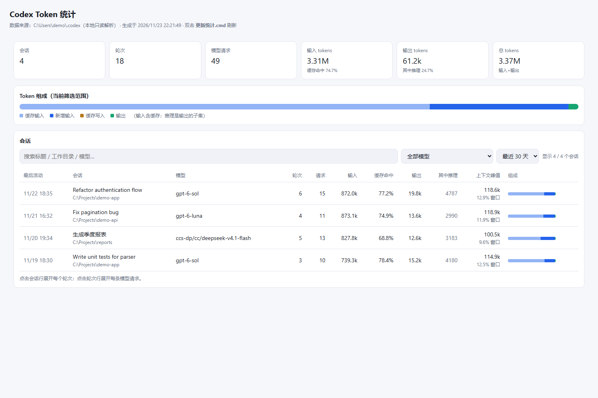

# Codex Token HUD

A tiny always-on-top token usage overlay for the **ChatGPT / Codex desktop app on Windows**, plus an offline HTML dashboard for per-turn / per-request token composition.

[中文说明](README.zh-CN.md)




## Features

- **Floating status bar** — model, output speed, total tokens, cache hit rate and context usage, styled after the DSH status strip.
- **Follows the active conversation** — reads the chat header title with Windows OCR, maps it to a Codex thread through `session_index.jsonl`, and switches the numbers when you switch conversations.
- **Only visible when ChatGPT/Codex is in the foreground** — hides when minimized or another app is active.
- **Transparent / translucent** — per-pixel alpha layered window; toggle a translucent background for readability.
- **Auto width** — the bar measures the text and resizes itself, so long model names such as `ccs-dp/cc/deepseek-v4.1-flash` never overflow.
- **Draggable and pinnable** — drag anywhere, right-click for the menu, `固定位置` locks the position.
- **Detached from consoles** — `start.cmd` launches it through `launch.vbs` / `wscript.exe`, so closing any PowerShell or console window does not terminate the widget.
- **Session costs from CC Switch** — Hover to see the recorded USD amount and request count for each model in the current conversation. This optional feature reads `%USERPROFILE%\.cc-switch\cc-switch.db` locally. Click speed, tokens, or context for details. Click outside the card to dismiss it.
- **Size presets** — right-click → 窗口大小 (85% / 100% / 115% / 130%) scales both the bar and the cost panel; the choice is saved.
- **Survives app restarts** — when ChatGPT/Codex exits the HUD hides but keeps running, so it reappears as soon as the app is started again; the logon entry starts it with Windows.
- **Offline dashboard** — `update.cmd` parses local session logs and generates a self-contained `index.html`: per session, per turn and per request input/output/cache tokens, cache hit rate, context window usage and throughput.

## Requirements

- Windows 10/11.
- ChatGPT desktop app (the one that ships Codex, `OpenAI.Codex`).
- Windows PowerShell 5.1 (built in).
- Optional: Node.js 18+ for the HTML dashboard.
- The OCR language pack matching your Codex UI language (e.g. `zh-Hans-CN` or `en-US`); Windows Settings → Time & Language → Language.

## Install

1. Download the latest `CodexTokenHUD-*.zip` from Releases and extract it.
2. Run `install.cmd` (or `powershell -ExecutionPolicy Bypass -File .\install.ps1`).
3. The HUD installs to `%LOCALAPPDATA%\CodexTokenHUD`, adds a Start Menu shortcut and enables auto start.

From source:

```powershell
git clone <repo-url>
cd codex-token-hud
powershell -ExecutionPolicy Bypass -File .\install.ps1
```

Installer options: `-NoStartup`, `-NoLaunch`, `-DesktopShortcut`, `-InstallDir <path>`.

## Usage

The bar appears when the ChatGPT/Codex window is in the foreground.

Right-click the bar for:

| Item | Meaning |
| --- | --- |
| 固定位置 | Lock the bar where it is (disables dragging) |
| 跟随 Codex 窗口 | Dock the bar to the top-right of the Codex window |
| 半透明背景 | Toggle the translucent background (off = fully transparent) |
| 开机自启（与 ChatGPT 一起） | Enable/disable the auto start entry |
| 立即刷新 | Re-read the current session immediately |
| 打开统计看板 | Open the HTML token dashboard |
| 退出 | Quit the HUD |

The bar auto-hides when ChatGPT/Codex is not the foreground window and stays available when the app exits. The next Windows login starts it again with the app.

Dashboard: run `%LOCALAPPDATA%\CodexTokenHUD\update.cmd`, or use the HUD menu item.

## How it works

- All data comes from local files under `%USERPROFILE%\.codex`:
  - `sessions/**/*.jsonl` — per-request `token_usage_record` events (fallback: `token_count`).
  - `session_index.jsonl` — thread id ↔ title mapping for OCR matching.
- The HUD captures the Codex chat header with `PrintWindow`, OCRs the title with the built-in Windows OCR engine, and fuzzy-matches it (character bigram similarity) against the thread index.
- Rendering uses a layered window with per-pixel alpha (`UpdateLayeredWindow`), so there is no injected code and no modification of the app.
- No network requests, no telemetry, no writing into the Codex app; the HUD only reads logs and its own settings.

## Limitations

- Windows only; built for the ChatGPT/Codex desktop app.
- OCR depends on the installed Windows language pack and can misread truncated or heavily decorated titles; the HUD then falls back to the most recently updated thread.
- The dashboard is an after-the-fact report; run `update.cmd` to refresh.
- Codex session formats may change between releases; parsing is defensive but not future-proof.

## Uninstall

```powershell
powershell -ExecutionPolicy Bypass -File .\uninstall.ps1
```

This stops the HUD, removes the auto start entry and shortcuts, and deletes `%LOCALAPPDATA%\CodexTokenHUD` (use `-KeepFiles` to keep it).

## Build

```powershell
# rebuild the dashboard (requires Node.js)
node .\src\dashboard\build.mjs

# build a release zip into dist/
powershell -ExecutionPolicy Bypass -File .\build-release.ps1 -Version 1.0.0
```

## License

MIT
