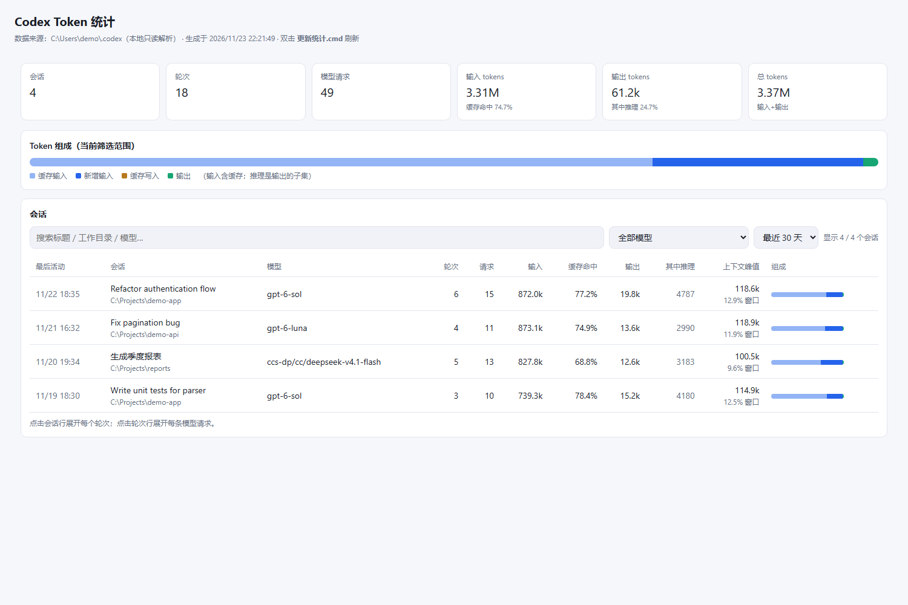

# Codex Token HUD

给 **Windows 上的 ChatGPT / Codex 桌面端** 用的 token 用量悬浮条，外加一个离线的 HTML 统计看板（按会话 / 轮次 / 请求统计输入、输出、缓存和上下文）。

[English](README.md)




## 功能

- **悬浮状态条**：显示模型、输出速度、累计 token、缓存命中率、上下文占比，样式对齐 DSH 的状态条。
- **跟随对话切换**：用 Windows OCR 识别聊天区顶部的会话标题，通过 `session_index.jsonl` 映射到 Codex 会话，切换对话时数字跟着换。
- **只在前台显示**：ChatGPT/Codex 不是当前前台窗口或被最小化时自动隐藏。
- **透明 / 半透明**：逐像素 alpha 的分层窗口，默认带一层半透明底（可关），文字始终可读。
- **宽度自适应**：按文字实测宽度自动伸缩，`ccs-dp/cc/deepseek-v4.1-flash` 这种长模型名不会溢出。
- **可拖动、可固定**：整条都能拖，右键任意位置出菜单，「固定位置」后锁定。
- **随应用启停**：写入 `HKCU\...\Run`，登录时随 ChatGPT 一起启动；ChatGPT 退出后自动退出。
- **离线看板**：`update.cmd` 解析本地会话日志，生成自包含的 `index.html`，按会话 / 轮次 / 请求展示输入、输出、缓存命中、上下文窗口占比和速度。

## 环境要求

- Windows 10/11。
- ChatGPT 桌面端（带 Codex 的那个，包名 `OpenAI.Codex`）。
- Windows PowerShell 5.1（系统自带）。
- 可选：Node.js 18+（只有 HTML 看板需要）。
- Windows OCR 语言包要覆盖 Codex 界面语言（中文一般是 `zh-Hans-CN`）；在「设置 → 时间和语言 → 语言」里安装。

## 安装

1. 从 Releases 下载最新的 `CodexTokenHUD-*.zip` 并解压。
2. 双击 `install.cmd`（或运行 `powershell -ExecutionPolicy Bypass -File .\install.ps1`）。
3. 程序安装到 `%LOCALAPPDATA%\CodexTokenHUD`，创建开始菜单快捷方式，并开启开机自启。

从源码安装：

```powershell
git clone <repo-url>
cd codex-token-hud
powershell -ExecutionPolicy Bypass -File .\install.ps1
```

安装参数：`-NoStartup`、`-NoLaunch`、`-DesktopShortcut`、`-InstallDir <路径>`。

## 使用

切到 ChatGPT/Codex 窗口，状态条就会出现。右键状态条：

| 菜单项 | 作用 |
| --- | --- |
| 固定位置 | 锁定当前坐标，禁止拖动 |
| 跟随 Codex 窗口 | 停靠到 Codex 窗口右上角 |
| 半透明背景 | 切换半透明底（关闭后纯透明） |
| 开机自启（与 ChatGPT 一起） | 开关开机自启 |
| 立即刷新 | 立刻重读当前会话 |
| 打开统计看板 | 打开 HTML 统计页 |
| 退出 | 关闭悬浮条 |

ChatGPT/Codex 不在前台时状态条自动隐藏；ChatGPT 退出时它自动退出，下次登录再随应用启动。

看板：运行 `%LOCALAPPDATA%\CodexTokenHUD\update.cmd`，或右键状态条选「打开统计看板」。

## 原理

- 数据全部来自 `%USERPROFILE%\.codex` 下的本地文件：
  - `sessions/**/*.jsonl`：每次请求的 `token_usage_record`（旧日志回退到 `token_count`）。
  - `session_index.jsonl`：会话 id 与标题的映射，用于 OCR 匹配。
- 悬浮条用 `PrintWindow` 截取 Codex 聊天区头部，调用 Windows 自带 OCR 识别标题，再用字符二元组相似度做模糊匹配。
- 绘制用分层窗口 + `UpdateLayeredWindow` 逐像素 alpha；不注入、不修改 Codex 应用。
- 不联网、不上报、不写入 Codex 目录，只读取日志和写自己的配置。

## 限制

- 仅支持 Windows，且面向 ChatGPT/Codex 桌面端。
- OCR 依赖系统语言包；标题被截断或装饰过多时可能认错，此时退回“最近更新的会话”。
- 看板是事后统计，需要运行 `update.cmd` 刷新。
- Codex 会话格式可能随版本变化；解析做了容错，但不保证永远兼容。

## 卸载

```powershell
powershell -ExecutionPolicy Bypass -File .\uninstall.ps1
```

会停止进程、删除开机自启项和快捷方式，并删除 `%LOCALAPPDATA%\CodexTokenHUD`（加 `-KeepFiles` 可保留文件）。

## 构建

```powershell
# 重新生成看板（需要 Node.js）
node .\src\dashboard\build.mjs

# 生成 dist/ 下的发布 zip
powershell -ExecutionPolicy Bypass -File .\build-release.ps1 -Version 1.0.0
```

## 许可

MIT
